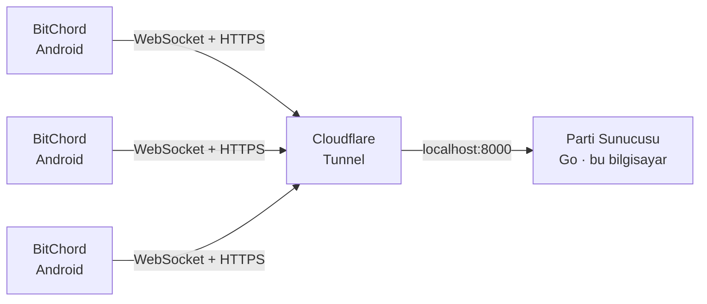

# BitChord Parti Sunucusu

**Windows'ta tek tıkla kendi "Birlikte Dinle" sunucun.** Arkadaşlarınla aynı şarkıyı, aynı saniyede, kendi sunucun üzerinden dinle.


---

## Neden var?

[BitChord](https://github.com/kushagrasinghx/BitChord) açık kaynak bir YouTube Music istemcisi ve içinde **Listen Together** (birlikte dinle) özelliği var. Ama:

- Resmî sunucu **5 cihazla** sınırlı,
- Kendi sunucunu kurmak Go, ters proxy, TLS, DNS bilgisi istiyor,
- Çoğu kişi bu yüzden özelliği hiç kullanamıyor.

Bu depo o boşluğu dolduruyor: **kur.bat → baslat.bat → hazır.** Go kurman gerekmiyor, port açman gerekmiyor, modem ayarı yok.

---

## Kurulum

**1. İndir**

Sağ üstteki yeşil **Code** düğmesi → **Download ZIP** → bir klasöre çıkar.

**2. Kur**

`kur.bat` dosyasına çift tıkla. İki dosya indirilir (toplam ~70 MB), 30 saniye sürer.

**3. Başlat**

`baslat.bat` dosyasına çift tıkla. Kara pencerede şu çıkar:

```
==============================================
 SUNUCU ADRESI (uygulamaya bunu gir):

 https://....trycloudflare.com

==============================================
Adres panoya kopyalandi.
```

Adres **~6 saniyede** hazır olur ve otomatik olarak panoya kopyalanır.

---

## Kullanım

1. BitChord uygulaması → **Ayarlar → Listen Together**
2. **Sunucu adresi** alanına yukarıdaki `https://` adresini yapıştır (sonunda `/` olmasın)
3. **Parti oluştur** → 6 haneli kod çıkar
4. Arkadaşların da aynı adresi girip kodu yazar

Hepsi aynı şarkının aynı saniyesinde olur. DJ modu için **host-only control** açabilirsin: o zaman play/pause/sıra sadece sende olur.

Kapatmak için: `Ctrl+C`, `Q` veya `durdur.bat`.

---

## Nasıl çalışıyor?



Sunucu şarkıyı **çalmaz ve iletmez** — sadece "şu an X. milisaniyedeyiz" bilgisini tutar. Her cihaz saat farkını ping/pong ile ölçüp kendi konumunu düzeltir. Bu yüzden bant genişliği neredeyse sıfırdır; ses her cihazın kendi YouTube bağlantısından gelir.

Teknik ayrıntılar için: [`kaynak/README.md`](kaynak/README.md)

---

## Ayarlar

`baslat.ps1` dosyasını Not Defteri ile aç, en üstteki `# ---------- AYARLAR ----------` bölümünü düzenle (istersen ortam değişkeni olarak da verebilirsin):

| Değişken / Ayar | Varsayılan | Ne yapar |
|---|---|---|
| `JAM_MAX_MEMBERS` | `10` | Parti başına cihaz (2–10) |
| `JAM_MAX_PARTIES` | `50` | Aynı anda açılabilecek parti |
| `JAM_MAX_UPCOMING_QUEUE` | `25` | Sıradaki maksimum şarkı |
| `PORT` | `8000` | Sunucunun dinlediği port |
| `JAM_TRUST_PROXY` | `true` | Cloudflare arkasında gerçek IP |
| `$tunnelName` / `$publicUrl` | *(boş)* | İsteğe bağlı sabit Cloudflare *named tunnel* adı ve `https://` adresi |

---

## SSS

**Adres neden her açılışta değişiyor?**
Cloudflare'in ücretsiz "quick tunnel" hizmeti her seferinde yeni bir ad üretir. Sabit adres istiyorsan kendi domainin + Cloudflare hesabıyla *named tunnel* kurup `baslat.ps1` içindeki `$tunnelName` ve `$publicUrl` satırlarını doldurabilirsin (README'nin altındaki Geliştirme bölümü).

**Kaç kişi katılabilir?**
Varsayılan 10 cihaz. `JAM_MAX_MEMBERS` ile değiştirilebilir (uygulama arayüzü 2–10 arasına izin verir).

**Sunucu kapanınca ne olur?**
Partiler ve sıra sıfırlanır — durum bellekte tutulur, veritabanı yok. Sunucu bir sebeple çökerse başlatıcı onu otomatik geri açar (5 denemeye kadar), adres aynı kalır.

**Güvenli mi?**
Trafik Cloudflare üzerinden TLS ile geçer. Ama adresi bilen herkes kendi partisini açabilir; sadece arkadaşlarınla paylaş. Sunucu bilgisayarında `0.0.0.0:8000` üzerinde dinler (seçtiğin `PORT` neyse o), modem/yönlendiricide port açılmaz ve dış trafik Cloudflare Tüneli üzerinden yerel `127.0.0.1:8000` bağlantısına yönlendirilir. Windows Güvenlik Duvarı uyarı verirse sadece **Özel ağlar** için izin verebilir veya iptal edebilirsin; tünel yerel loopback kullandığı için yine çalışır.

**Linux / macOS?**
Sunucu Go ile yazıldığı için platformdan bağımsız. `kaynak/` içinde `go build` çalıştırıp `cloudflared` ile aynı şekilde tünel açabilirsin. Bu depodaki başlatıcılar Windows içindir.

**Para ödemem gerekiyor mu?**
Hayır. Cloudflare quick tunnel ve BitChord backend'i ücretsiz. Cloudflare hesapsız tünellerde uptime garantisi vermez — ev partisi için fazlasıyla yeterli.

---

## Sorun giderme

| Belirti | Çözüm |
|---|---|
| `portu baska bir program tarafindan kullaniliyor` | Belirtilen port dolu. Diğer sunucuyu kapat (`durdur.bat`) veya `baslat.ps1` içinde `PORT` değiştir. |
| `Tunel acilamadi` | İnternet/Cloudflare engeli. Farklı ağ (mobil hotspot) dene. |
| Uygulama bağlanamıyor | Adres `https://` ile başlasın, sonunda `/` olmasın. |
| Windows SmartScreen / Defender uyarısı | İndirilen `.exe` dosyaları imzasız olabilir; "Ek bilgi → Yine de çalıştır" seç veya `kaynak/` içinden kendin derle. |
| İndirilen `.exe` dosyalarını güncellemek için | Önce `durdur.bat` çalıştır, sonra komut satırından `kur.bat -Force` çalıştır. |
| Ses kayması | Bilgisayarın saatini otomatik güncelle (Ayarlar → Saat ve dil). |
| Pencere kapanınca sunucu ölüyor | Normal: sunucu o pencerenin altında çalışır. `baslat.bat` ile tekrar aç. |

---

## Geliştirme

`kaynak/` klasörü, [kushagrasinghx/BitChord](https://github.com/kushagrasinghx/BitChord) deposunun `backend/` dizininin bir kopyasıdır — **tek satır yama** ile:

```diff
- maxMembers := 5
+ maxMembers := config.MaxMembers
```

Bu yama olmadan `JAM_MAX_MEMBERS` ayarı yok sayılıyor ve her parti 5 cihazda takılı kalıyor.

Kendin derlemek için:

```bash
# Go 1.27+ gerekir
cd kaynak
go build -o ../bitchord-jam.exe .
```

**Sabit adres (named tunnel) kurmak istersen:** Cloudflare hesabı + bir domain al, `cloudflared tunnel create <ad>` ve `cloudflared tunnel route dns <ad> <domain>` ile tünel oluştur, ardından `baslat.ps1` üstündeki `$tunnelName` ve `$publicUrl` değişkenlerini doldur.

---

## Lisans

Bu depo **GPL-3.0** altında. Sunucu kodu [kushagrasinghx/BitChord](https://github.com/kushagrasinghx/BitChord) projesine aittir ve aynı lisansla dağıtılır. Ayrıntılar: [NOTICE.md](NOTICE.md).

BitChord ile resmî bir bağlantısı yoktur; topluluk tarafından hazırlanmış bir kurulum aracıdır.

---

## English

One-click Windows launcher for the **BitChord Listen Together** backend.

1. Download ZIP → extract
2. Run `kur.bat` (installs `cloudflared.exe` + `bitchord-jam.exe`, ~70 MB, verifies SHA-256)
3. Run `baslat.bat` → it prints an `https://...trycloudflare.com` address (copied to clipboard)
4. In BitChord: **Settings → Listen Together** → paste the address → create a party → share the 6-character code
5. Press `Ctrl+C`, `Q`, or run `durdur.bat` to stop (only stops processes belonging to that folder). Use `kur.bat -Force` to re-download binaries.

No Go, no port forwarding, no DNS setup. Up to 10 devices per party by default. The server only syncs playback position — audio is streamed by each device from YouTube Music. GPL-3.0, built on [kushagrasinghx/BitChord](https://github.com/kushagrasinghx/BitChord).
